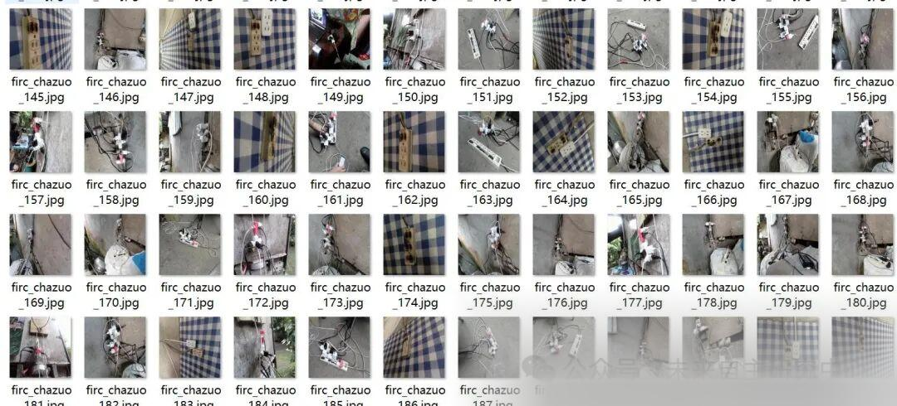
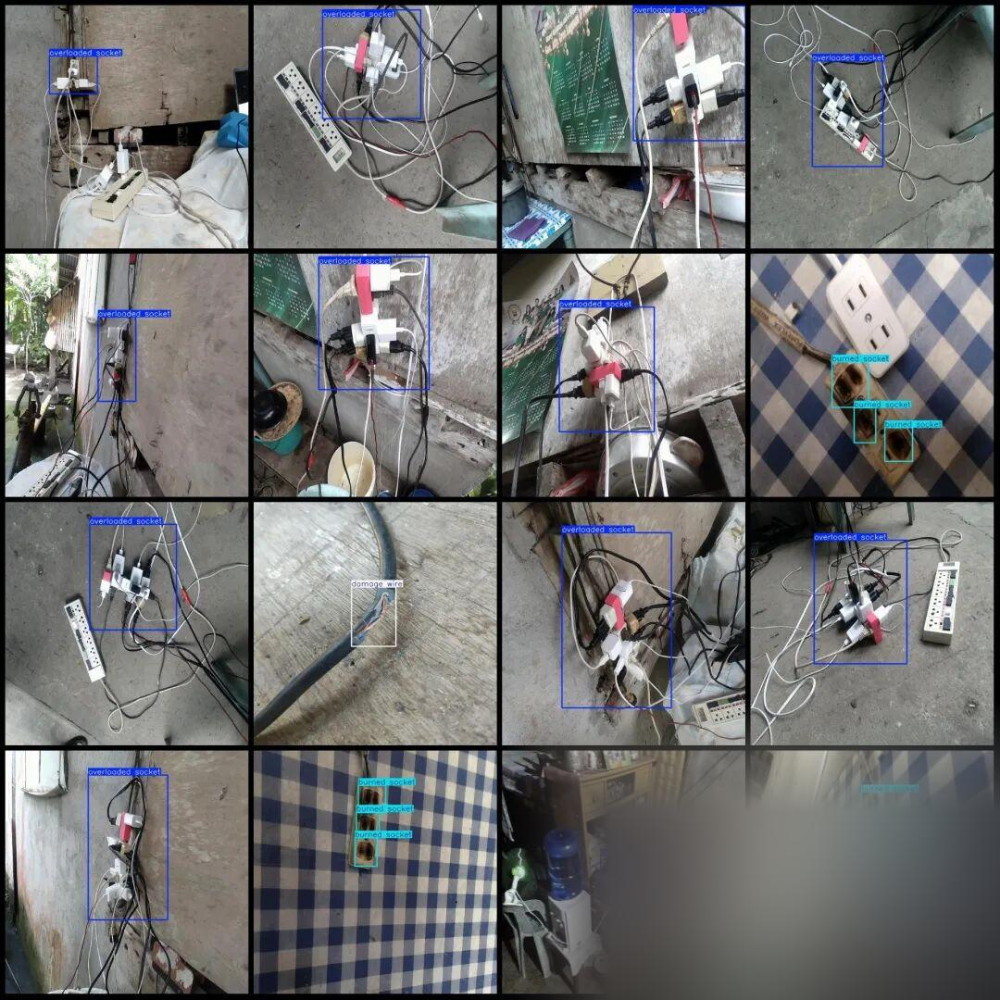

# Smart Grid - Socket Hazard and Defect Detection Dataset VOC+YOLO format with 6468 images in 4 categories

Dataset format: Pascal VOC format + YOLO format (txt file without split path, only containing jpg images and corresponding VOC format xml files and yolo format txt files)

Number of images (number of jpg files): 6468

Number of annotations (number of xml files): 6468

Number of annotations (number of txt files): 6468

Labeling category count: 4

Label category names (note that the order of categories in the YOLO format does not correspond to this, but is based on the labels folder's classes.txt): ["burned socket", "damage wire", "open copper", "overloaded socket"] => [Burned socket, Damaged wire, Open copper, Overloaded socket]

Number of boxes labeled in each category:

Burned socket frame count = 5469

Damaged wire count = 1197

Open copper frame count = 296

Overloaded socket frame count = 3237

Total frame count: 10199

Using labelImg:

Annotation rules: Draw a rectangle around the category.

Important Notice: No

Special : This dataset does not guarantee the accuracy or precision of the trained models or weight files. The dataset is provided with accurate and reasonable annotations only.

Image Preview:

Annotation example:

## Payment

Here is a pay link on Stripe ( https://buy.stripe.com/3cs8yP7sY87d0vu9AB ). Please contact me lonlonago@foxmail.com after funding $89, and I will send you a complete data files , thank you!

